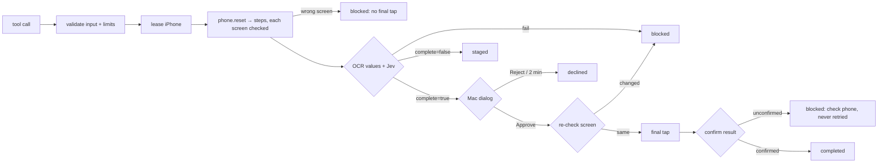
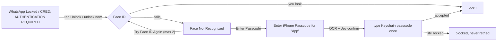

# Phone actions (`src/phone`)

Fixed, named actions for a real iPhone, driven through the local
[Ghosthand](https://ghosthand.dev/) daemon. Every action is a chain of small,
hardcoded **steps**. Each step declares the screen it starts on and the screen it
leaves, and both are checked on the device. Steps pair only where one ends and
the next starts, and the compiler rejects any other pairing.

Both the actions and the steps are exposed from one registry:

- the `neo-phone` **MCP server** (`npm run phone:mcp`, stdio), registered in
  `opencode.json`. Agents use it instead of Ghosthand's own MCP;
- a **CLI**: `npm run phone -- <tool> '<json input>'`.

## Actions

Each action starts from any screen. The first step, `phone.reset`, goes to the Home Screen.

| Action               | Route (in the apps themselves; no Safari, no links)                  | Final tap (`complete: true` + approval) |
| -------------------- | -------------------------------------------------------------------- | --------------------------------------- |
| `send_whatsapp_text` | WhatsApp → chat list → search the chat name or number → chat → draft | Send (Enter)                            |
| `order_water`        | The same, to the configured vendor, with the order text              | Send (Enter)                            |
| `send_money`         | CRED → UPI → "pay to" → UPI ID → payee's Pay → amount                | SEND MONEY; **you enter the UPI PIN**   |
| `book_rapido`        | Rapido → destination → first suggestion → vehicle (experimental)     | Book                                    |
| `open_app`           | Home Screen → Spotlight → the app → past its Face ID lock            | none                                    |

The phone's Bluetooth keyboard types US-ASCII only, so messages, chat names and
addresses must be plain ASCII (no emoji, no ₹). Input schemas reject anything else.

## Steps, and how they pair

```mermaid
flowchart LR
  A((anywhere)) -- phone_reset --> H[home]
  H -- spotlight_open --> S[spotlight]
  S -- "spotlight_launch {app}" --> L["&lt;app&gt;.open?locked"]
  L -- "unlock_app {app}" --> O["&lt;app&gt;.open"]
  O -- whatsapp_chat_list --> WL[whatsapp.chat_list]
  WL -- whatsapp_open_search --> WS[whatsapp.search]
  WS -- "whatsapp_open_chat {name}<br/>whatsapp_open_chat_by_number {number}" --> WC[whatsapp.chat]
  WC -- "whatsapp_type_draft {text}" --> WD[whatsapp.draft]
  WD == "whatsapp_send (gated)" ==> WC
  O -- cred_home --> CH[cred.home]
  CH -- cred_open_upi --> CS[cred.scanner]
  CS -- cred_open_pay_search --> CP[cred.pay_search]
  CP -- "cred_find_payee {vpa}" --> CF[cred.payee_found]
  CF -- "cred_open_payee {vpa}" --> CA[cred.amount]
  CA -- "cred_enter_amount" --> CE[cred.amount_entered]
  CE == "cred_send_money (gated)" ==> CN[cred.pin]
```



- A step runs only when its start screen shows. Otherwise it is refused with
  `blocked` and no input is sent. After acting, it waits (bounded) for its end
  screen, so a step that "worked" but left the wrong screen also stops the chain.
- `phone_screen` reads the screen (OCR, no input) and names the known screens it
  matches, so an agent can tell which step can run next.
- In code, steps pair with `chain(...).then(...)`. `Step<From, To>` is typed by
  screen name: `chain(showChatList).then(typeDraft("hi"))` does not compile
  (a draft needs a chat, not the chat list), and neither does skipping
  `unlock_app` after a launch. See [`steps/README.md`](steps/README.md).

## Saved chains (`chains.ts`)

A chain is a named list of steps with variables, saved in
`~/.config/neo/chains.json` (or `NEO_PHONE_CHAINS`). It runs in one call instead
of one call per step. The file is installed from the `configs/neo` package of
the dotfiles repo with `just update neo`. That repo is public, so keep chat
names, numbers and UPI IDs as variables rather than saved values.

```json
{
  "chains": {
    "note-to-self": {
      "description": "Type a note into your own WhatsApp chat",
      "vars": { "chat": "Saved Messages", "text": null },
      "steps": [
        { "tool": "open_app", "input": { "app": "whatsapp" } },
        "whatsapp_chat_list",
        "whatsapp_open_search",
        { "tool": "whatsapp_open_chat", "input": { "name": "${chat}" } },
        { "tool": "whatsapp_type_draft", "input": { "text": "${text}" } }
      ]
    }
  }
}
```

```sh
npm run phone -- list_chains
npm run phone -- chain note-to-self '{"text":"Buy milk"}'
npm run phone -- run_chain '{"name":"whatsapp-to-chat","vars":{"chat":"Family","text":"Home by 8"},"complete":true}'
```

- **Steps** are step tools (as listed by `npm run phone`) by name, or
  `{ "tool", "input" }`. Actions are not steps; `open_app` is.
- **Variables:** `vars` gives saved values; `null` means the run must supply one.
  `${name}` is replaced inside strings, and a string that is only `${name}` takes
  the value's type, so `"amountInr": "${amount}"` stays a number. Unknown or
  missing variables are refused.
- **Checked before the phone is leased:** every step's input against that step's
  own schema, every pair of steps (each must start where the one before ends,
  as `chain().then()` checks at compile time), the payment limit, and that an
  irreversible step comes only last. A refused chain touches nothing.
- **`complete` is never saved** in the file. It is given to `run_chain` when the
  chain runs (default `false`), and finishing still needs Approve on the Mac.
  `chain <name>` on the CLI always stages.
- On the device each step still checks its start and end screen, exactly as when
  run one by one.

## Safety model



- **Default stops early.** `complete` defaults to `false`: the action fills
  everything in and returns `staged`, so you finish on the phone.
- **Irreversible steps are separate.** Only `whatsapp_send`, `cred_send_money` and
  `rapido_book` (and the actions that end in them) take `complete`. They run
  through `finish()` in `final.ts` and nothing else.
- **Two independent checks** before any final tap: exact values in code (the UPI
  ID, the amount on CRED's amount line, the draft's first words, the chat name)
  and a Jev yes/no on the screenshot at `p ≥ 0.8` (`JEV_MIN_YES`).
- **Approval is outside the agent.** A macOS dialog shows the exact summary;
  `Reject` is the default and cancel button, and it times out to `declined`.
- **The screen is checked again after approval**, because approval can take minutes.
- **One secret, tightly scoped.** neo never types a UPI PIN or a password. The
  iPhone passcode is typed only to get past an app's Face ID lock (see below).
- **Bounded:** one lease per call (180 s idle timeout), every wait and retry has a
  limit, 90 s per Ghosthand request, 30 s per Jev call, a `maxAmountInr` limit
  (default ₹5,000) checked before the phone is touched.

| Outcome     | Meaning                                                                  |
| ----------- | ------------------------------------------------------------------------ |
| `staged`    | Filled in; final tap not made                                            |
| `completed` | Final tap made and its result confirmed; `next` says what is left to you |
| `declined`  | You rejected the dialog or it timed out; nothing was sent                |
| `blocked`   | A check failed; `reason` says whether the final tap happened             |

## Modules

| Module                                 | Responsibility                                                                               |
| -------------------------------------- | -------------------------------------------------------------------------------------------- |
| `ghosthand.ts`                         | HTTP client for the daemon's unix socket (`~/.ghosthand/daemon.sock`); typed problems        |
| `phone.ts`                             | `withPhone`: lease, act, always release; `Phone` (read, tap, key, type, scroll, pause)       |
| `navigation.ts`                        | Line pickers and bounded polling over OCR text                                               |
| `flow.ts`                              | `Screen`, `Step`, `chain` (typed pairing), `runStep` (start and end screen checks)           |
| `final.ts`                             | `FinalStep` and `finish`: checks, approval, re-check, final tap, confirmation                |
| `steps/`                               | The hardcoded steps per app: system, WhatsApp, CRED, Rapido                                  |
| `unlock.ts`                            | Face ID app locks: Face ID, then the Keychain passcode typed once into the confirmed prompt  |
| `verify.ts`                            | Screen checks: OCR expectations in code plus the Jev (TypeSafe) judge                        |
| `approval.ts`                          | The macOS approval dialog                                                                    |
| `formats.ts`                           | Phone numbers, UPI IDs, amounts                                                              |
| `config.ts`                            | `~/.config/neo/phone.json`: contacts, water vendor, payment limit                            |
| `actions.ts`                           | The actions: fixed chains of steps                                                           |
| `chains.ts`                            | Saved chains: load `chains.json`, fill in variables, check pairs; `run_chain`, `list_chains` |
| `tool.ts`, `tools.ts`, `step-tools.ts` | Tool definitions and the registry shared by the MCP server and the CLI                       |
| `server.ts`, `cli.ts`                  | Entry points                                                                                 |

## Setup

1. Ghosthand ready: `ghosthand setup status` reports `"ready": true`.
2. `TYPESAFE_API_KEY` set in the environment (Jev).
3. For apps locked with Face ID (WhatsApp and CRED both are): save the iPhone
   passcode in the **login** keychain. The command prompts for it, so it never
   appears in your shell history:
   `security add-generic-password -s neo-phone -a iphone-passcode -w`.
   An item in the Passwords app is not found. Without the item, a locked app
   stops the action with `blocked`.
4. Optional config at `~/.config/neo/phone.json` (or `NEO_PHONE_CONFIG`). It
   stays outside the repo:

```json
{
  "contacts": { "Amma": "+919876543210" },
  "water": {
    "vendor": "Water Supplier",
    "address": "Flat 4B, KR Garden",
    "item": "20 L water can"
  },
  "payments": { "maxAmountInr": 5000 }
}
```

`to` (and `water.vendor`) is a contact name above, a phone number with country
code, or otherwise a WhatsApp chat name exactly as WhatsApp shows it.

## Usage

```sh
npm run phone -- send_whatsapp_text '{"to":"Saved Messages","text":"Home by 8"}'
npm run phone -- send_whatsapp_text '{"to":"+919876543210","text":"Home by 8"}'
npm run phone -- order_water '{"quantity":2,"note":"before 10am"}'
npm run phone -- send_money '{"vpa":"shop@okhdfcbank","payeeName":"Ravi Stores","amountInr":250}'
npm run phone -- open_app '{"app":"cred"}'

# Steps on their own: each refuses to run unless its start screen shows.
npm run phone -- phone_screen
npm run phone -- whatsapp_open_search
```

In code, an action is a chain of steps and an optional final step:

```ts
const route = openApp("whatsapp")
  .then(showChatList)
  .then(openSearch)
  .then(openChat("Saved Messages"))
  .then(typeDraft("Home by 8"));
const outcome = await perform(
  deps,
  route,
  send({ text: "Home by 8", recipient: "me" }),
  false,
);
```

## Face ID app locks (`unlock.ts`)



- A Face ID scan shows no text for a few seconds, and CRED asks only after its
  launch screen. So "open" counts only once the app's own content has shown on two
  reads in a row (at most six reads, 1.5 s apart).
- Jev is asked whether the screen is iOS's own prompt titled
  `Enter iPhone Passcode for "<App>"`. Its keypad is hidden while a hardware
  keyboard is connected, so the question says so. OCR must read that exact title too.
- The passcode is read from the Keychain per call. It is never logged, put in
  config or returned in an outcome or error. A wrong passcode counts toward the
  iPhone's lockout, so it is typed once and never retried.

## Privacy

Each screen check sends one screenshot and its OCR text to TypeSafe's API (Jev
image input is experimental). Ghosthand runs locally over USB and Bluetooth; the
local socket API does not go through ghosthand.dev.

## Device findings (iOS 27.2, iPhone 17, November 2026)

- **Enter does nothing** in Spotlight (either kind) or in Safari's address bar
  from the Bluetooth keyboard. neo taps instead, and opens no links.
- Spotlight: the one from the Home Screen's **Search** pill accepts taps; the
  `cmd+Space` one does not. Only the top hit's **icon** opens the app; its label
  does not respond. iOS reopens Spotlight with the last query, whose results hide
  the pill, so `spotlight.launch` selects all before typing.
- Two Home presses less than about a second apart open the App Switcher;
  `phone.reset` waits 1.2 s between presses.
- iOS capitalizes the first letter typed into a message box ("Neo test …"), so
  draft checks ignore case.
- WhatsApp: the search bar ("Ask Meta AI or Search", OCR "Al") hides once the
  chat list scrolls; scrolling up shows it. OCR sometimes reads the back button
  as only its unread count ("5"). "Edited 14:19" sits just above the message box,
  so the draft is read on the "+" button's row. Searching a number's last ten
  digits lists that number's chat first under "Chats".
- CRED: the UPI button opens a QR scanner with a "pay to …" field; its search
  shows the bank's name for a UPI ID with a Pay button that opens the amount sheet.
  OCR reads ₹ as "F" or "{", so the amount is read from the sheet's amount line only.

Verified live, staged (`complete: false`): WhatsApp by chat name and by number
(Face ID → passcode), and CRED to the amount sheet (Face ID → passcode).

## Not yet verified on the iPhone

- that Enter sends in WhatsApp (`whatsapp_send`), and that SEND MONEY leads to
  CRED's UPI PIN screen (`cred_send_money`): both need a real send;
- every Rapido label (`rapido.ts`).
