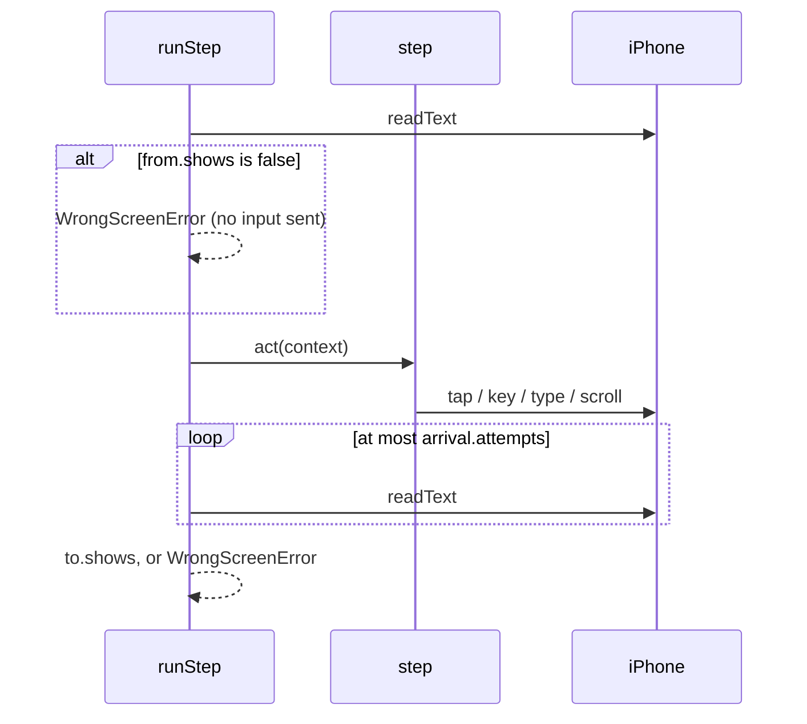

# Steps (`src/phone/steps`)

The hardcoded moves neo makes on the iPhone, one module per app. A step is a
`Step<From, To>` from `../flow.ts`: one fixed move that runs only when its `from`
screen shows and must leave its `to` screen showing. Irreversible moves are
`FinalStep`s from `../final.ts` and only run through `finish()`.

| Module        | Screens it defines                                                                           | Steps                                                                                                          |
| ------------- | -------------------------------------------------------------------------------------------- | -------------------------------------------------------------------------------------------------------------- |
| `system.ts`   | `home`, `spotlight`, `<app>.open`                                                            | `reset` (base setup), `openSpotlight`, `launchFromSpotlight(app)`, `unlock(app, screen)`; chain `openApp(app)` |
| `whatsapp.ts` | `whatsapp.chat_list`, `.search`, `.chat`, `chatWith(name)`, `draftOf(text)`                  | `showChatList`, `openSearch`, `openChat(name)`, `openChatByNumber(digits)`, `typeDraft(text)`; final `send`    |
| `cred.ts`     | `cred.home`, `.scanner`, `.pay_search`, `.payee_found`, `.amount`, `.amount_entered`, `.pin` | `showCredHome`, `openScanner`, `openPaySearch`, `findPayee`, `openPayee`, `enterAmount`; final `sendMoney`     |
| `rapido.ts`   | `rapido.home`, `.vehicles`, `.ready`, `.requested` (experimental labels)                     | `showRapidoHome`, `searchDrop`, `pickVehicle`; final `book`                                                    |

## Pairing

```ts
import { chain } from "../flow.js";

const route = openApp("whatsapp") // anywhere → whatsapp.open
  .then(showChatList) // whatsapp.open → whatsapp.chat_list
  .then(openSearch) // → whatsapp.search
  .then(openChat("Saved Messages")) // → whatsapp.chat
  .then(typeDraft("Home by 8")); // → whatsapp.draft

chain(showChatList).then(typeDraft("hi")); // does not compile: needs whatsapp.chat
chain(openSpotlight).then(launchFromSpotlight("cred")).then(showCredHome); // does not compile: unlock first
```

- `then` takes a step whose `from` is the chain's `to`, or `anywhere` (`reset`).
- An app that was just launched is `MaybeLocked<"<app>.open">`. Only `unlock`
  leads on from it, so no chain can skip the Face ID lock.
- A chain is itself a `Step`, so chains pair with steps and with other chains.
- `runStep` runs the flat list. For each step it checks the start screen, acts,
  then polls for the end screen (bounded, `arrival` overrides the default 12 × 500 ms).



## Adding a step

1. Read the screens on the device first (`ghosthand screentext` and a screenshot)
   and note each label and its position.
2. Define a `Screen` for each new end screen, recognized from OCR text only, and
   strict enough not to match its neighbours. `phone_screen` lists them.
3. Write the step as a constant or a factory over its fixed inputs. It may not
   tap, type or open anything taken from free-form input beyond what its own
   schema validates.
4. Add a fake screen with the coordinates you read to `test/phone`, and a test
   that runs the chain through it. Then run it once on the iPhone with
   `complete: false`.
5. Register it in `../step-tools.ts` with its `from` and `to` names.
